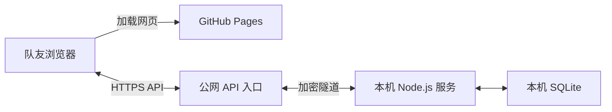

# GitHub Pages 前端与本机后端

本轮目标：用一个固定 GitHub Pages 网页入口；账号、团队、成员、模型配置和数据库继续保存在部署者电脑上。

当前状态：静态预览已发布到 https://qiiii1.github.io/team-harness-web/ ，尚未连接业务 API。用户已明确选择不允许 Cloudflare 转发，暂时保留本机／局域网连接。预览禁止业务请求，原局域网服务正常运行。`HARNESS_ALLOW_CLOUDFLARE=0` 已保存，分享启动器默认拒绝启动。

前端仓库：https://github.com/Qiiii1/team-harness-web 。只发布静态网页文件，不发布本机后端源码、数据库、证书、密码或模型 Key。

## 请求如何传输



网页加载后，由队友浏览器直接请求 API。GitHub Pages 提供静态文件，不代理业务请求，也不运行后端程序。[GitHub Pages 说明](https://docs.github.com/en/pages/getting-started-with-github-pages/what-is-github-pages)

为了让队友无需安装局域网证书，本机 API 通过 Cloudflare 临时 HTTPS 隧道提供入口。数据存储仍在本机，网络请求会经过 Cloudflare。后端自身也使用 HTTPS，隧道工具使用项目 CA 验证本机证书。

## 技术调整

- 网页资源使用相对路径，支持 GitHub Pages 的仓库子目录；管理页面使用 `#admin` 路由，刷新不会请求不存在的 `/admin` 静态页面。
- `config.js` 仅包含公开 API 地址。构建脚本只复制明确列出的网页文件。
- 本机后端明确允许 `https://qiiii1.github.io` 这个 Origin，处理 CORS 预检，拒绝其他来源。
- 跨域页面使用显式 Bearer 会话，不依赖第三方 Cookie；令牌只保存在当前网页标签页的 sessionStorage，数据库保存摘要，会话过期、停用和强制退出规则继续生效。
- 同源本机网页仍使用原来的 HttpOnly Cookie 与 CSRF 校验。
- 管理权限继续由后端检查，公网入口不会自动赋予任何账号团队或系统管理权限。

## 部署者如何启动

首次需要准备项目专用的 `cloudflared` 工具和可用于发布此仓库的 GitHub CLI 登录。在 `.env.web.local` 中配置：

```dotenv
HARNESS_PAGES_REPOSITORY=Qiiii1/team-harness-web
```

以下为将来明确授权公网转发后才可采用的部署方式；当前不要执行。必须显式启用 `HARNESS_ALLOW_CLOUDFLARE=1`，分享启动器才会运行。届时先停止占用 4185 端口的旧 `npm start`，再运行：

```sh
npm run share:pages
```

这个命令将：

1. 编译后端并创建临时 HTTPS 隧道。
2. 将准确的隧道 Host 和 Pages Origin 传入本机服务，启动后端。
3. 把当前 API 地址写入前端配置，只提交网页文件到独立前端仓库的 `codex/pages` 分支。
4. 启用/更新 GitHub Pages，并输出网页地址。

保持该进程和电脑在线。Ctrl+C 会同时停止 API 与隧道；业务数据库仍保留。

GitHub Pages 网页地址固定；临时隧道地址在重新创建后会变化，启动命令会同步更新并重新发布前端配置。队友在 GitHub 构建完成后刷新同一网页即可。临时隧道没有在线保障，长期使用应换成绑定域名的固定 API 入口。[Cloudflare 临时隧道说明](https://developers.cloudflare.com/tunnel/get-started/quick-tunnels/)

需要单独构建或发布时：

```sh
PAGES_API_BASE_URL=https://你的API地址 npm run build:pages
PAGES_API_BASE_URL=https://你的API地址 npm run publish:pages
```

公开构建产物位于 `.local/pages-site`，最新 Pages 发布信息位于 `.local/web/pages-deployment.json`，临时隧道信息位于 `.local/web/public-link.json`。这些文件并不包含模型 Key。

## 验证

- 只允许指定 Pages Origin 的预检和 API 请求；未知 Origin 与未授权请求被拒绝。
- 跨域注册、登录、会话恢复、退出和撤销生效；第三方 Cookie 不参与认证。
- 用独立静态服务器模拟 `/project/` 子目录，验证网页资源、创建团队、刷新登录状态及 `#admin` 刷新。
- 原同源网页、后台和 HTTPS 浏览器流程继续验证。

实际发布地址及公网连通性以成功部署与现场请求结果为准；创建仓库不代表 API 或 Pages 已经上线。
